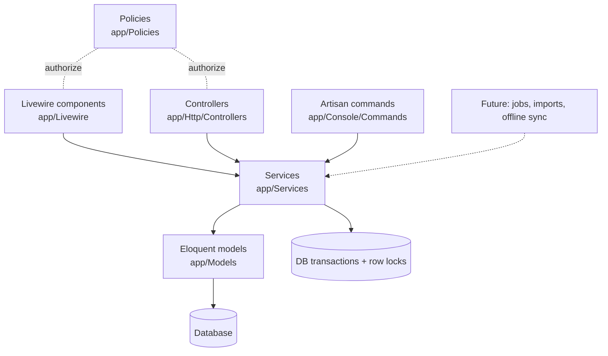

# Architecture

## Overview

Laravel 13 monolith with a Livewire 4 UI and a service layer that owns all business rules.



Concrete example in the code today: `Users\Edit::deactivate()` (Livewire) → `authorize('deactivate')` (`UserPolicy`) → `UserService::deactivate()` (rules + transaction) → `User` model / `sessions` table. The same `UserService::create()` is used by both the `Users\Create` component and the `app:create-admin-user` command.

## Layers and responsibilities

| Layer | Responsibility | Must not |
|---|---|---|
| Routes + middleware (`routes/web.php`, `bootstrap/app.php`) | Map URLs; coarse protection (`guest`, `auth`, `active`, `can:`) | Contain logic |
| Entry points (Livewire, controllers, commands) | Input shape validation (Form objects / `validate()`), `authorize()`, call a service, map `DomainException` to UI errors, HTTP concerns (session regenerate/invalidate, redirects) | Contain business rules or money arithmetic |
| Policies | *Who* may do something (role checks) | Business invariants (those go in services) |
| Services | Business rules, normalisation (e.g. lower-case email), transactions, locking, rate limiting, domain exceptions | Know about Livewire state or HTTP responses |
| Models | Persistence, casts, simple scopes (`User::scopeActive`) | Multi-model workflows |

## Livewire ↔ service communication

Services are method-injected into Livewire actions:

```php
public function save(UserService $userService): void
{
    $this->authorize('update', $this->user);
    try {
        $userService->update($this->user, $this->form->payload(), auth()->user());
    } catch (UserManagementException $exception) {
        $this->addError('form.role', $exception->getMessage());
        return;
    }
    ...
}
```

Livewire update requests (`POST /livewire-*/update`) do not re-run all route middleware, so every action authorises again.

## Concurrency

Read-then-write rules run inside `DB::transaction()` with `lockForUpdate()`. Example: `UserService::ensureAnotherActiveAdminExists()` locks the other active admin rows, so two admins demoting each other simultaneously cannot leave zero admins. Financial operations will follow the same pattern.

## Error model

Business-rule violations throw subclasses of `App\Exceptions\DomainException` with a user-presentable message. Anything else is treated as a bug and reaches Laravel's exception handler (JSON for `api/*` or JSON-expecting requests).

## Design patterns in use

- Service layer (ADR-0004), domain exceptions, Livewire Form objects (`App\Livewire\Forms\UserForm`), policies, backed enums for fixed value sets (`UserRole`), attribute-based model config (`#[Fillable]`, `#[Hidden]`), UUID keys via `HasUuids` (ADR-0002).
