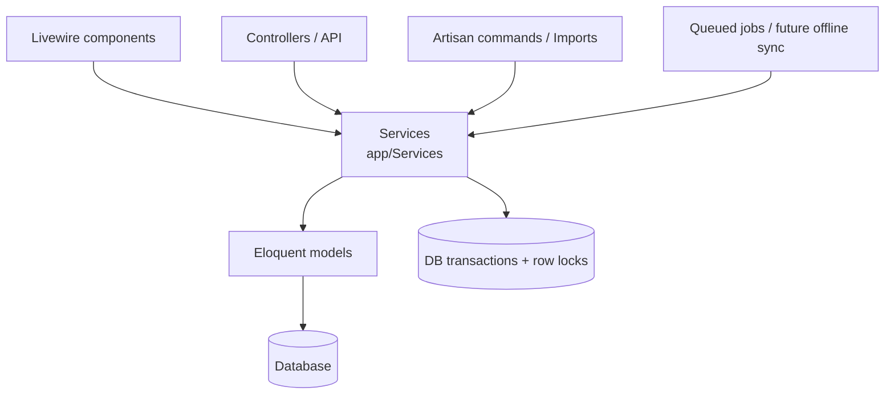

# Architecture

## Current state

Standard Laravel 13 application structure with no custom layers yet:

- `bootstrap/app.php` registers `routes/web.php`, `routes/console.php` and the `/up` health route, adds no custom middleware, and renders exceptions as JSON for `api/*` requests or requests that expect JSON.
- `routes/web.php` has one closure route: `GET /` → `welcome` view.
- `app/Models/User.php` is the only model.
- `app/Providers/AppServiceProvider.php` is empty.

## Target architecture (Proposed — ADR-0003, ADR-0004)

### Layers and responsibilities

| Layer | Responsibility | Must not |
|---|---|---|
| Entry points (Livewire, controllers, commands, jobs) | Input validation (shape/format), authorisation, calling one service method, rendering | Contain business rules or money arithmetic |
| Services | Business rules, financial calculations, transactions, locking, domain exceptions | Know about HTTP requests or Livewire state |
| Models | Persistence, relationships, casts, simple scopes | Perform multi-model business workflows |

### Sharing logic between entry points

Because every entry point calls the same service method, a sale created from the UI, a bulk import, or a future offline sync goes through identical validation and calculation. This is the main reason for the service layer (ADR-0004).

### Livewire ↔ service communication

Livewire is not installed. When it is: a component action validates input, calls `$this->authorize()`, invokes a constructor-/method-injected service, catches domain exceptions and maps them to validation errors or flash messages.

### Concurrency

Financial operations will use `DB::transaction()` with `lockForUpdate()` on the rows whose balances are read and changed, so two simultaneous payments cannot both see the same outstanding balance. Documented in detail in `FINANCIAL_LOGIC.md` once implemented.

## Design patterns in use

- Laravel conventions only (service container, Eloquent active record, attribute-based model config such as `#[Fillable]` / `#[Hidden]` on `User`).
- Service layer: Proposed.
