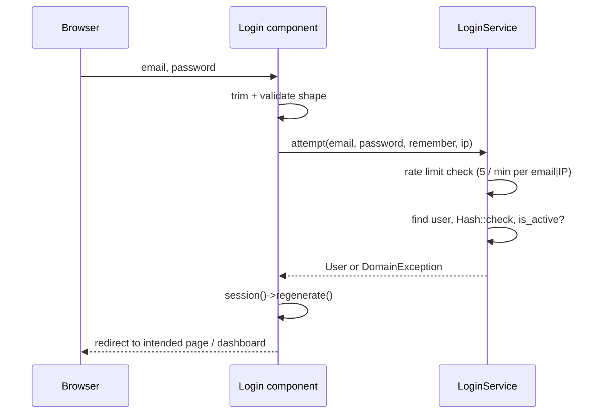

# Authentication and Authorization

_As of 2026-11-01 (Phase 1). Hand-built on Laravel's session guard — no starter kit (ADR-0009)._

## Authentication

| Capability | Where |
|---|---|
| Sign in (email + password, "remember me") | `Auth\Login` component → `LoginService::attempt()` |
| Sign out | `POST /logout` → `LogoutController` |
| Forgot / reset password (emailed link, 60-min token) | `Auth\ForgotPassword`, `Auth\ResetPassword` → `PasswordResetService` |
| First administrator | `php artisan app:create-admin-user` |
| Public self-registration | **Not provided** — administrators create accounts |

Flow:

Details:
- Guard `web` (session driver, Eloquent provider) from `config/auth.php`.
- Emails are compared and stored lower-case.
- Unknown email and wrong password return the same message (`auth.failed`).
- Session is regenerated after sign-in (prevents session fixation) and invalidated + CSRF token regenerated on sign-out.
- **`active` middleware** (`App\Http\Middleware\EnsureUserIsActive`, alias registered in `bootstrap/app.php`) runs on every signed-in route and signs out users deactivated mid-session.
- Deactivation, password reset and admin-set passwords delete the affected user's `sessions` rows and rotate `remember_token`, so existing sessions and "remember me" cookies stop working immediately.
- Signed-in users visiting guest pages are redirected to `dashboard` (`redirectUsersTo` in `bootstrap/app.php`); guests hitting protected pages go to `login`.

## Roles

`App\Enums\UserRole`, stored in `users.role`:

| Role | Value | Can |
|---|---|---|
| Administrator | `admin` | Everything: users, customers (incl. deactivation), products and prices |
| Cashier | `cashier` | Dashboard; add and edit customers; view products and prices |

Planned split for later phases (ADR-0010): admins manage users, products, prices, promotions and approve refunds/cancellations; cashiers record customers, sales and payments.

The role picker in the users panel shows each role's label and one-line `UserRole::description()`.

## Authorization

- Policies in `app/Policies` (auto-discovered).

**`UserPolicy`**

| Ability | Rule |
|---|---|
| `viewAny`, `create`, `update` | user is admin |
| `deactivate` | user is admin **and** not the target |

**`CustomerPolicy`**

| Ability | Rule |
|---|---|
| `viewAny`, `create`, `update` | any signed-in (active) user |
| `changeStatus` (deactivate/reactivate) | user is admin |

**`ProductPolicy`** (ADR-0012)

| Ability | Rule |
|---|---|
| `viewAny` | any signed-in (active) user |
| `create`, `update`, `changeStatus` | user is admin |

- Enforced at three levels: route middleware `can:viewAny,<Model>` on `/users`, `/customers` and `/products`; `$this->authorize()` in each Livewire `mount()` and action; views hide controls the user can't use (`@can`), e.g. the Users link, product edit buttons and customer deactivation.
- Business invariants that are not about "who" (last active admin, own role) live in `UserService`, not policies.

## Route protection map

| Routes | Middleware |
|---|---|
| `/login`, `/forgot-password`, `/reset-password/{token}` | `guest` |
| `/`, `/dashboard`, `POST /logout` | `auth`, `active` |
| `/users` (list; create/edit happen in a panel on this page) | `auth`, `active`, `can:viewAny,User` |
| `/customers` | `auth`, `active`, `can:viewAny,Customer` |
| `/products` | `auth`, `active`, `can:viewAny,Product` |
| `/up` | public health check |
