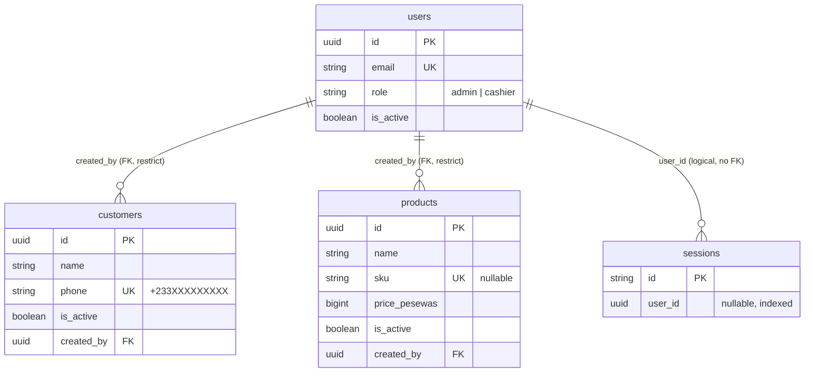

# Database Relationships

_As of 2026-11-01 (Phase 2)._

## Eloquent relationships

| Model | Method | Type | Target | Key |
|---|---|---|---|---|
| `Customer` | `creator()` | belongsTo | `User` | `customers.created_by` |
| `Product` | `creator()` | belongsTo | `User` | `products.created_by` |

`User` declares no inverse relationships (not needed yet).

## Database-level relationships

| From | To | Kind | On delete | Why |
|---|---|---|---|---|
| `customers.created_by` | `users.id` | many customers → one user | **restrict** | Users are never deleted (deactivated instead); the restriction guarantees the "added by" record can't be orphaned |
| `products.created_by` | `users.id` | many products → one user | **restrict** | Same as above |
| `sessions.user_id` | `users.id` | many sessions → one user (nullable) | none (index only, no FK) | Framework table; `UserService` deletes a user's session rows when needed |

`password_reset_tokens` is keyed by `email` and is not linked to `users` by any constraint. `cache`, `cache_locks`, `jobs`, `job_batches` and `failed_jobs` are infrastructure tables with no relationships.

## Cascading and deletion rules

- No table cascades deletes. Users, customers and products are deactivated (`is_active = false`), never deleted, so history stays intact.
- Every future financial FK (sales → customers, sale lines → products, payments → sales) should use `restrictOnDelete` (ADR-0004).
