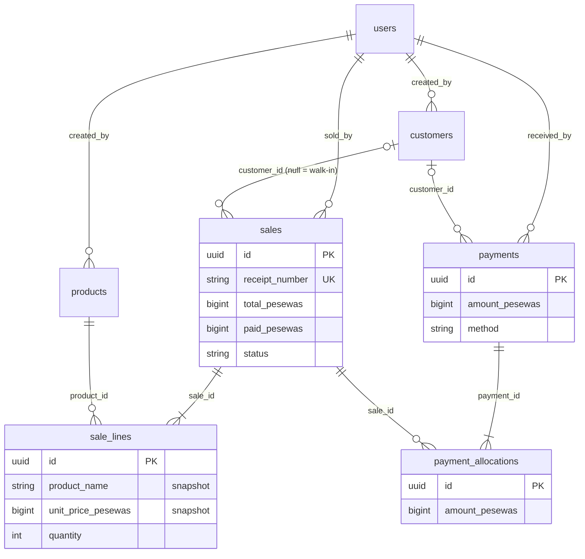

# Database Relationships

_As of 2026-11-01 (Phase 3)._

## Eloquent relationships

| Model | Method | Type | Target | Key |
|---|---|---|---|---|
| `Customer` | `creator()` | belongsTo | `User` | `customers.created_by` |
| `Customer` | `sales()` | hasMany | `Sale` | `sales.customer_id` |
| `Customer` | `payments()` | hasMany | `Payment` | `payments.customer_id` |
| `Product` | `creator()` | belongsTo | `User` | `products.created_by` |
| `Sale` | `customer()` | belongsTo | `Customer` (nullable = walk-in) | `sales.customer_id` |
| `Sale` | `seller()` | belongsTo | `User` | `sales.sold_by` |
| `Sale` | `lines()` | hasMany | `SaleLine` | `sale_lines.sale_id` |
| `Sale` | `allocations()` | hasMany | `PaymentAllocation` | `payment_allocations.sale_id` |
| `SaleLine` | `sale()`, `product()` | belongsTo | `Sale`, `Product` | |
| `Payment` | `customer()` | belongsTo | `Customer` (nullable) | `payments.customer_id` |
| `Payment` | `receiver()` | belongsTo | `User` | `payments.received_by` |
| `Payment` | `allocations()` | hasMany | `PaymentAllocation` | `payment_allocations.payment_id` |
| `PaymentAllocation` | `payment()`, `sale()` | belongsTo | `Payment`, `Sale` | |

Payments and sales are **many-to-many through `payment_allocations`**: one payment can settle several sales (oldest first), and one sale can be paid by several payments (instalments).

## Database-level relationships

All foreign keys use **`restrictOnDelete`**: nothing financial can be deleted while referenced, and nothing cascades.

| From | To | Kind |
|---|---|---|
| `customers.created_by`, `products.created_by` | `users.id` | many → one |
| `sales.customer_id` (nullable) | `customers.id` | many → one |
| `sales.sold_by` | `users.id` | many → one |
| `sale_lines.sale_id` | `sales.id` | many → one |
| `sale_lines.product_id` | `products.id` | many → one |
| `payments.customer_id` (nullable) | `customers.id` | many → one |
| `payments.received_by` | `users.id` | many → one |
| `payment_allocations.payment_id` | `payments.id` | many → one (unique with `sale_id`) |
| `payment_allocations.sale_id` | `sales.id` | many → one |
| `sessions.user_id` | `users.id` | logical only (no FK) |

`counters`, `password_reset_tokens`, `cache*`, `jobs`, `job_batches`, `failed_jobs` have no relationships.

## Cascading and deletion rules

- No table cascades deletes. Users, customers and products are deactivated; sales and payments are permanent (ADR-0004).
- Future refunds/cancellations must add new rows (reversals) rather than delete or edit these.
