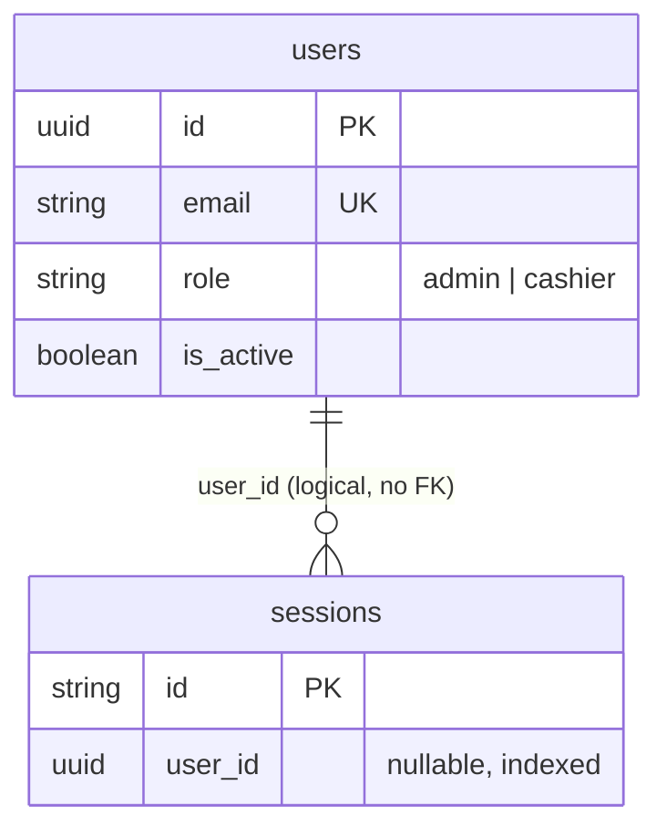

# Database Relationships

_As of 2026-11-01 (Phase 1)._

## Eloquent relationships

None are defined. `App\Models\User` declares no relationship methods.

## Database-level relationships

There are **no foreign key constraints** in the schema.

| From | To | Kind | Enforcement |
|---|---|---|---|
| `sessions.user_id` (uuid) | `users.id` (uuid) | many sessions → one user (nullable) | Index only, no FK. Users are never hard-deleted (they are deactivated), and `UserService::deactivate()` deletes the user's session rows explicitly |

`password_reset_tokens` is keyed by `email` and is not linked to `users` by any constraint. `cache`, `cache_locks`, `jobs`, `job_batches` and `failed_jobs` are infrastructure tables with no relationships.

## Cascading and deletion rules

- Users are never deleted through the application; deactivation (`is_active = false`) is used instead so future sales/payments can keep referring to the staff member who recorded them.
- When business tables are added, record for each FK whether it uses `restrictOnDelete`, `cascadeOnDelete` or `nullOnDelete`, and why. Financial tables are intended to use `restrictOnDelete` (ADR-0004).
