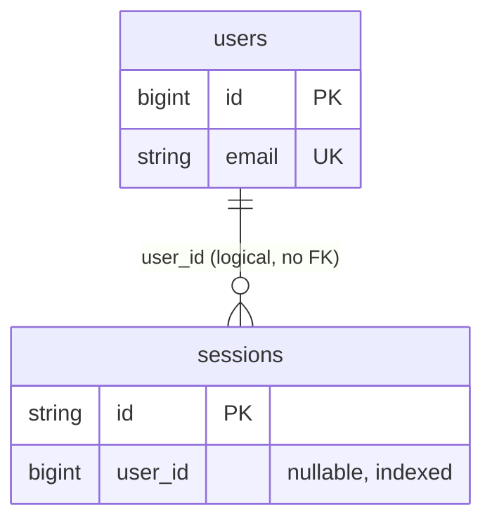

# Database Relationships

_As of 2026-11-01._

## Eloquent relationships

None are defined. `App\Models\User` declares no relationship methods.

## Database-level relationships

There are **no foreign key constraints** in the schema.

| From | To | Kind | Enforcement |
|---|---|---|---|
| `sessions.user_id` | `users.id` | many sessions → one user (nullable) | Index only, no FK; deleting a user leaves orphaned session rows (harmless; they expire) |

`password_reset_tokens` is keyed by `email` and is not linked to `users` by any constraint. `cache`, `cache_locks`, `jobs`, `job_batches` and `failed_jobs` are infrastructure tables with no relationships.

## Cascading and deletion rules

None defined. When business tables are added, record for each FK whether it uses `restrictOnDelete`, `cascadeOnDelete` or `nullOnDelete`, and why. Financial tables are intended to use `restrictOnDelete` (ADR-0004).
