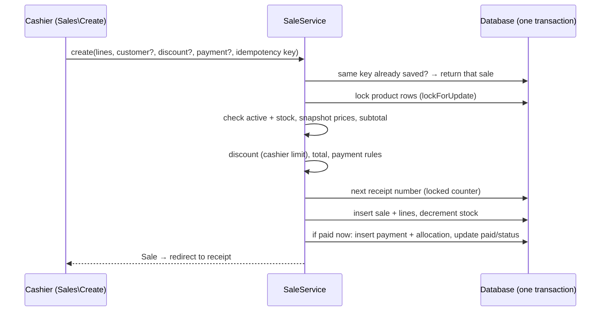

# Sales Management

_Implemented in Phase 3 (2026-11-01). Refunds and cancellations are not built yet._

## What a sale is

A completed transaction at the counter: one or more products, an optional customer, an optional discount, and an optional payment taken there and then. Anything not paid becomes the customer's balance (credit). Sales are **never edited or deleted** after saving (ADR-0004); corrections will be made by refunds/cancellations in a later phase.

## Flow

Any rule violation throws `SaleException` and the whole transaction rolls back: no stock change, no receipt number used, no payment.

## Rules (see BUSINESS_RULES.md S1–S12)

- At least one product; quantities are whole numbers ≥ 1; repeated products are merged.
- Products must be active and have enough stock (checked on the locked row).
- Each line copies the product **name, SKU and unit price** at the moment of sale.
- Discount: one per sale, as GH₵ or %, never more than the subtotal; cashiers up to `sales.cashier_max_discount_percent` (default 10%) of the subtotal; admins up to 100%.
- Total = subtotal − discount. Payment at the counter: 0 to total, with a method (Cash, Mobile Money, Bank transfer, Card) and optional reference.
- A balance (credit) requires a customer; walk-in sales must be paid in full. No minimum deposit.
- Customer must be active.
- Receipt numbers `R-000001`, `R-000002`, … never reused, no gaps from failed sales.

## Screens

| Screen | Route | Notes |
|---|---|---|
| Point of sale (New sale) | `/sales/new` (`sales.create`) | Full-screen POS (`layouts::pos`, ADR-0018): product grid with photos and category chips, search/scan with Enter to add, cart with −/+ steppers, customer picker, discount, "Charge" button that opens a Take payment dialog (amount due, payment-method tiles, cash received with quick-cash buttons, change due or balance, reference, note, "Complete sale"), then a "Sale complete" screen (receipt number, change due, Print receipt, New sale). `?customer=<id>` preselects a customer. Details in LIVEWIRE_COMPONENTS.md. |
| Sales list | `/sales` (`sales.index`) | Search receipt or customer; period (today default, 7/30 days, all); status (Paid / Part-paid / Unpaid); tiles for count, amount sold and still owed. |
| Receipt | `/sales/{sale}` (`sales.show`) | Printable (sidebar/header hidden in print). Lines, subtotal, discount and reason, total, paid, balance, every payment applied to the sale, served by, notes. "Receive payment" shortcut when a balance remains. |

## Code

`app/Services/SaleService.php`, `app/Services/ReceiptNumberService.php`, `app/Models/{Sale,SaleLine}.php`, `app/Enums/SaleStatus.php`, `app/Exceptions/Sales/SaleException.php`, `app/Policies/SalePolicy.php`, `app/Livewire/Sales/{Create,Index,Show}.php`, `config/sales.php`. Tests: `tests/Feature/Services/SaleServiceTest.php`, `tests/Feature/Sales/SalesScreensTest.php`.

## Not yet implemented

Refunds, cancellations/voids, returns to stock, editing a sale, multiple discounts or per-line discounts, promotions, tax/VAT, sale-level delivery tracking, SMS receipts.
